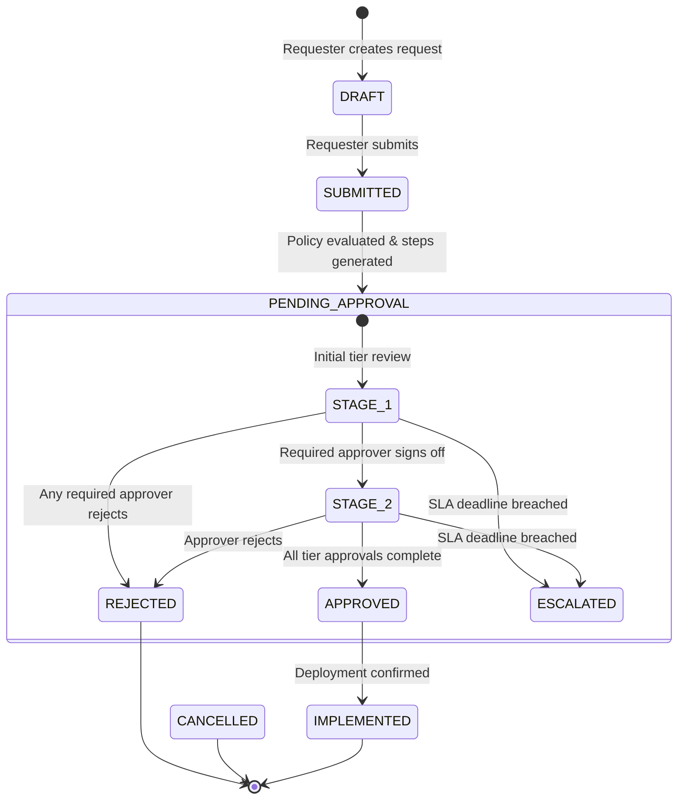

# AegisFlow Enterprise — Technical Architecture & System Design Specification
## Operation Ironclad Reference Architecture (ADR-001 through ADR-006)

---

## 1. System Overview & Monorepo Topology

AegisFlow Enterprise is architected as an explicit-boundary TypeScript monorepo designed for deterministic local testing, zero-leak multi-tenancy, and high-concurrency approval orchestration.

```text
examples/enterprise-sdlc-lab/project/
├── apps/
│   ├── api/                 # Fastify / Express REST API and middleware pipeline
│   │   ├── src/
│   │   │   ├── middleware/  # Auth, TenantContext, Idempotency, Audit
│   │   │   ├── routes/      # ChangeRequests, Approvals, Audit, Health, Telemetry
│   │   │   └── server.ts
│   └── web/                 # Accessible operational dashboard and review queue (WCAG 2.1 AA)
│       ├── public/
│       └── src/
└── packages/
    ├── core/                # Pure domain models, finite state machine, SLA calculators
    │   ├── src/
    │   │   ├── entities/    # ChangeRequest, ApprovalPolicy, AuditLedger, Tenant
    │   │   ├── state/       # ChangeRequestStateMachine, TransitionGuards
    │   │   └── sla/         # BusinessHoursCalculator, EscalationEngine
    └── storage/             # Persistence layer with pluggable drivers (Memory, SQLite, SQL)
        ├── src/
        │   ├── repository/  # ScopedTenantRepository, AuditLedgerRepository
        │   └── drivers/
```

---

## 2. Multi-Tenant Isolation Architecture (ADR-001)

### Tenancy Model: Shared Process, Enforced Partitioning
- Every database query and memory access is scoped by a mandatory `tenantId`.
- **Tenant Context Isolation**: An immutable `TenantContext` is established at the API gateway layer via cryptographically validated tokens or headers (`X-Tenant-ID`).
- **Scoped Repository Pattern**: Storage repositories cannot instantiate queries without an explicit `tenantId`. All queries append `WHERE tenant_id = :tenantId`.
- **Cross-Tenant Attack Prevention**: Any attempt to access a resource whose `tenantId` mismatches the request's `TenantContext` immediately aborts with `403 Forbidden` and emits a high-priority security telemetry event.

---

## 3. Finite State Machine & Approval Workflow Engine (ADR-002)

### Change Request Lifecycle States


### Business Rules & Transition Guards
1. **Self-Approval Ban**: Requesters are strictly prohibited from approving their own change requests (`requesterId !== approverId`).
2. **Finance Department Double-Approval**: Changes tagged with category `FINANCE` or estimated budget impact > \$100,000 require an explicit two-tier approval including a designated Finance Director role.
3. **Emergency Changes**: Changes marked `EMERGENCY` generate an expedited single-tier approval path but enforce mandatory post-facto auditor sign-off within 24 hours.

---

## 4. Idempotency & High-Concurrency Strategy (ADR-003)

1. **Idempotency Keys**: API mutating operations accept an `Idempotency-Key` header. Keys are stored with the hash of the payload and response for 24 hours. Duplicate requests return the cached response without re-executing state transitions.
2. **Optimistic Concurrency Control**: All entity records carry a monotonically increasing `version: number`. Updates must match `WHERE id = :id AND version = :expectedVersion`. Mismatches abort with `409 Conflict`, requiring client refresh.
3. **Concurrent Approval Arbitration**: If two designated managers attempt to approve the same stage simultaneously, the first write commits and increments the version; the second evaluates the new state and completes the step safely without double-counting.

---

## 5. Cryptographic Tamper-Evident Audit Ledger (ADR-004)

Enterprise compliance requires that audit logs cannot be modified or truncated retroactively.

### Hash-Chained Audit Ledger Architecture
Each audit record contains:
$$\text{RecordHash}_n = \text{SHA-256}\Big(\text{Sequence}_n \,\|\, \text{Timestamp}_n \,\|\, \text{TenantID}_n \,\|\, \text{ActorID}_n \,\|\, \text{Action}_n \,\|\, \text{PayloadHash}_n \,\|\, \text{RecordHash}_{n-1}\Big)$$

- **Genesis Record**: `RecordHash_0 = SHA-256("AEGISFLOW_GENESIS_RECORD")`
- **Verification Routine**: `auditLedger.verifyChainIntegrity(tenantId)` sequentially validates every record hash against its predecessor. Any manual edit, omission, or row insertion breaks the chain and triggers an audit failure alert.

---

## 6. Non-Functional Requirements & Acceptance Thresholds

| Metric | Target SLA | Verification Method |
|---|---|---|
| **P95 API Latency** | $< 45\text{ms}$ under 50 concurrent virtual clients | Automated local load test harness |
| **Tenant Boundary Leakage** | **Zero tolerance (0%)** | Adversarial cross-tenant penetration suite |
| **Audit Ledger Verification** | $100\%$ chain integrity validation | Automated tamper-injection suite |
| **UI Accessibility** | WCAG 2.1 AA Compliance | Keyboard navigation, ARIA labels, semantic markup |
| **Recovery from Interruption** | Zero data loss, clean restart from preserved state | Simulated process kill & restart tests |
