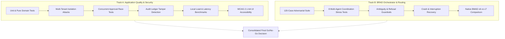

# AegisFlow Enterprise — Test Methodology & Evaluation Framework
## Operation Ironclad Verification Standards

---

## 1. Dual-Track Evaluation Framework

Operation Ironclad establishes two decoupled, strictly independent evaluation tracks:

> [!CAUTION]
> **Decoupled Scoring Principle**:
> A scenario where BRAD accurately routes an ambiguous prompt but the resulting code introduces a tenant leakage defect is a **Routing PASS / Application FAIL**. Conversely, clean code written without BRAD routing is **Application PASS / Routing NOT_RUN**. Under no circumstances are these dimensions conflated.

---

## 2. Result Classification Taxonomies

Every evaluated scenario and test case must be assigned exactly one canonical outcome:

| Outcome Code | Definition | Acceptance Criteria |
|---|---|---|
| **PASS** | Complete success | All assertions pass; exact native target selected; verifiable evidence produced. |
| **FAIL** | Concrete defect | Assertion failed; misrouted to wrong workflow; security boundary breached; wrong ticket modified. |
| **PARTIAL** | Incomplete execution | Valid target chosen but halted mid-stream, or succeeded only via degraded fallback. |
| **BLOCKED** | Environment impediment | Required external dependency or capability unavailable (e.g. Docker container down). |
| **NOT_RUN** | Deliberately unexecuted | Out of test scope or skipped due to upstream precondition failure. |

---

## 3. Strict Anti-Gaming Governance (Non-Negotiable)

1. **Role Attribution vs. Agent Execution**:
   - Referring to `"Maya (PM)"` or `"Marcus (Architect)"` in prompts reflects simulated user context. It is **never** counted as multi-agent execution unless a distinct host subagent context (`invoke_subagent` / subagent session ID) was dispatched.
2. **Naming vs. Invoking**:
   - Stating in assistant prose `"I will now invoke bmad-build"` without authentic execution is scored as `NATIVE_WORKFLOW_INLINE` or `NOT_VERIFIED`, never `HOST_NATIVE_INVOKED`.
3. **Execution vs. Scaffolding**:
   - Writing an automated test file to disk is scored as an implementation artifact. It contributes to zero test passes until executed by a runtime test runner with recorded exit code `0`.
4. **Independent Review Boundary**:
   - A code review conducted in the identical context that authored the changes is classified as `SELF_REVIEW_INLINE`. An `INDEPENDENT_REVIEW` requires a separate subagent context without inherited conversational memory.
5. **Frozen Oracle Rule**:
   - All 120 scenario expectations are frozen in `scenarios/expected-outcomes.json` prior to execution. Modifying expected outcomes post-run is strictly prohibited.
