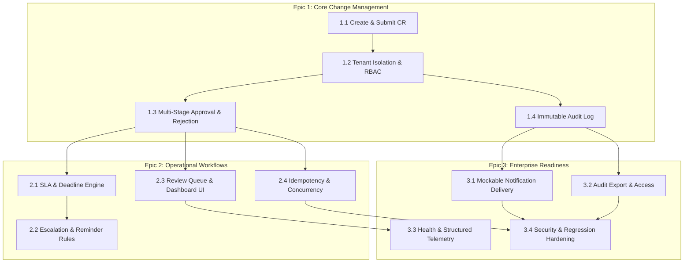

# AegisFlow Enterprise — Epics, Stories & Dependency DAG
## Sprint Delivery Plan & Critical Path Architecture

---

## Story Dependency Specifications

1. **Story 1.1 (Create & Submit)**: Foundation. Depends on pure domain model.
2. **Story 1.2 (Tenant Isolation & RBAC)**: Must land before any multi-tenant persistence or cross-tenant route is opened.
3. **Story 1.3 (Multi-Stage Approval)**: Depends on 1.1 and 1.2.
4. **Story 1.4 (Immutable Audit Log)**: Depends on 1.2. Every state change in 1.3 writes to 1.4.
5. **Story 2.1 (SLA & Deadlines)**: Depends on 1.3 state transitions.
6. **Story 2.2 (Escalation Rules)**: Depends on 2.1 deadlines.
7. **Story 2.3 (Review Queue Dashboard)**: Depends on 1.3 and 1.2.
8. **Story 2.4 (Idempotency & Concurrency)**: Depends on 1.3.
9. **Story 3.1 (Notifications)**: Depends on 1.3 and 1.4 events.
10. **Story 3.2 (Audit Export)**: Depends on 1.4.
11. **Story 3.3 (Health & Telemetry)**: Depends on API server framework.
12. **Story 3.4 (Security & Regression Hardening)**: Final quality gate. Depends on all prior stories.
