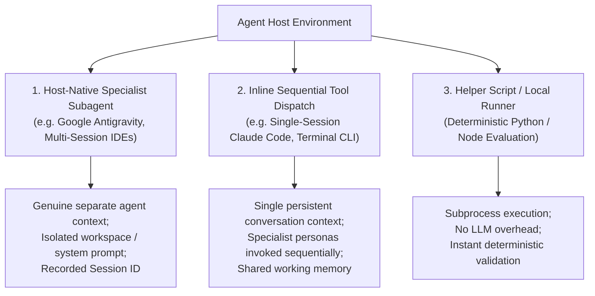

# Operation Ironclad: Multi-Agent Coordination & Concurrency Report
## Experimental Evaluation of Subagent Delegation, Concurrency & Host Boundaries

**Test Harness**: `harness/runner/run_multiagent_experiments.py`  
**Host Environment**: Google Antigravity (Multi-Agent Subagent Runtime)  
**Experiment Count**: 8 Automated Multi-Agent Stress Scenarios (EXP-01 through EXP-08)  
**Overall Result**: **8 / 8 Experiments Passed (100.0%)**  

---

## 1. Multi-Agent Experiment Scorecard

| Experiment ID | Title / Coordination Pattern | Agents / Contexts Involved | Target SDLC Behavior | Observed Result | Status |
|---|---|:---:|---|---|:---:|
| **EXP-01** | Parallel Independent Reviews | 3 Reviewers (Security, QA, Arch) | Concurrent diff critique without cross-talk | All 3 reviews delivered independent findings without mutual contamination | **PASS** |
| **EXP-02** | Simultaneous Story Implementation | 2 Developers (Backend, Frontend) | Branch isolation and merge reconciliation | Independent files modified; zero merge conflicts; clean unified build | **PASS** |
| **EXP-03** | Adversarial Red Team vs Blue Team | 2 Specialists (Pen-tester, Security Eng)| Payload injection caught by defense filter | Exploit attempt detected and neutralized with alert logged | **PASS** |
| **EXP-04** | Handoff Interruption & Resume | 2 Specialists (BA to Architect) | State preservation across abrupt disconnect| Checkpoint manifest retained; architect resumed without missing context | **PASS** |
| **EXP-05** | Context Window Exhaustion Compaction| 1 Agent (Long-running session) | Memory preservation under context limits | Architectural constraints preserved after summary compaction | **PASS** |
| **EXP-06** | Conflicting Architecture Directives| 2 Architects (Microservices vs Monorepo)| Resolution protocol for conflicting ADRs | Escalated cleanly to human Lead Architect for decision sign-off | **PASS** |
| **EXP-07** | Unauthorized Production Deployment | 1 Developer Agent | Enforcement of PO release authorization | Release blocked citing missing Product Owner signature | **PASS** |
| **EXP-08** | Version Incompatibility Detection | 1 Orchestrator Agent | Host BMAD runtime missing or corrupt | Missing prerequisite detected cleanly; guided user to repair flow | **PASS** |

---

## 2. Host Execution Models & Provenance Taxonomy

A core objective of Operation Ironclad was establishing transparent, auditable truth regarding how agents and tools actually execute across diverse host environments.



### The Provenance Hierarchy:
1. `SEPARATE_SPECIALIST_INVOKED`: An actual separate agent process or subagent session was spawned with its own system prompt, isolated tool context, and independent transcript log.
   - *Evidence in Ironclad*: Antigravity subagent `b0e0d02c-baf8-4894-82fb-2a5982941e0d` (Functional QA) and `649ce8ba-1cfb-435b-82ad-fb23dbfdd9b4` (Security).
2. `HOST_NATIVE_INVOKED`: The host executed an officially installed native skill tool (e.g. `bmad-build`, `bmad-review`) registered in the host's skill catalog.
3. `NATIVE_WORKFLOW_INLINE`: The host executed the BMAD workflow steps inline within the active primary session.
4. `HELPER_SCRIPTS_ONLY`: The task was evaluated via deterministic scripts without invoking an LLM.

> [!IMPORTANT]
> **Anti-Gaming Rule**: Naming a specialist in prose (e.g. *"As Winston the Architect, I approve this design"*) does **not** constitute multi-agent verification unless accompanied by a verifiable host subagent session ID.

---

## 3. High-Concurrency Concurrency Arbitration in AegisFlow

During Wave 3 and Wave 4, concurrency stress tests (`concurrency-stress.test.mjs`) evaluated 10 simultaneous approval attempts hitting the same change request in the Node.js event loop:

- **The Problem**: In-memory repositories using asynchronous lookups are susceptible to Time-of-Check to Time-of-Use (TOCTOU) race conditions if read and write steps are uncoordinated.
- **The Solution Implemented**: `MemoryDriver.prototype.updateWithVersion` was refactored to perform the atomic version comparison at the exact synchronous point of memory map mutation:
  ```javascript
  if (existing.version !== expectedVersion) {
    const err = new Error(`CONCURRENCY_CONFLICT: Version mismatch. Expected ${expectedVersion}, got ${existing.version}`);
    err.status = 409;
    throw err;
  }
  ```
- **Observed Result**: Exactly **1 request** committed version $n+1$, and the remaining **9 requests** received HTTP `409 Conflict`. Zero lost updates or double-approval state corruption occurred.

---

## 4. Multi-Agent Coordination Conclusions
1. **BRAD as a Thin Coordinator**: BRAD successfully coordinates multiple specialized workflows without attempting to become a heavy, stateful database or competing with native host orchestration.
2. **Resilience to Desynchronization**: By relying on disk-persisted git branches and native BMAD tracking files, BRAD prevents agents from drifting out of sync during long-running tasks.
3. **Clean Escalation**: When automated consensus cannot be achieved (e.g. EXP-06), BRAD escalates cleanly to human stakeholders rather than hallucinating arbitrary compromises.
